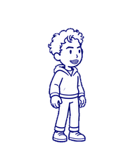
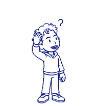

# 小姚 · Xiao Yao

一个蓝色手绘风格的动态小伙伴。蓬松头发、粗眉和亲切的笑容，陪你在 ChatGPT Work 里工作、思考和休息。

<p align="center">
  
  
</p>

## 领取并使用

1. 打开 **[领取小姚](https://chatgpt.com/s/sharepet_6aec6e8e287c8191b3d1219f8022bdeb)**，登录你的 ChatGPT 账号。
2. 按页面提示领取宠物。如果当前账号或工作区没有开放 Pets，页面可能无法使用，请以实际界面为准。
3. 在支持的 ChatGPT Work 界面进入 **设置 → 个性化 → Pet → 选择宠物**，选择“小姚”。

领取链接为公开链接：知道链接的人都可以领取。它复制的是宠物名称、描述和素材，不包含分享者的身份信息。

## 在 ChatGPT 桌面应用中使用

如果你的桌面应用支持宠物安装链接，可以点击 **[安装小姚到桌面应用](codex://pets/install?name=%E5%B0%8F%E5%A7%9A&imageUrl=https%3A%2F%2Fraw.githubusercontent.com%2FOldYao%2FLuckyOld-Yao%2Frefs%2Fheads%2Fmain%2Fassets%2Fxiaoyao.png&spriteVersionNumber=2)**，按应用提示完成安装，再在 **设置 → Pets** 中选择小姚。如果浏览器没有打开应用，可复制下面的链接到支持此协议的环境：

```text
codex://pets/install?name=%E5%B0%8F%E5%A7%9A&imageUrl=https%3A%2F%2Fraw.githubusercontent.com%2FOldYao%2FLuckyOld-Yao%2Frefs%2Fheads%2Fmain%2Fassets%2Fxiaoyao.png&spriteVersionNumber=2
```

桌面应用和网页端的宠物存储与显示方式可能不同。功能是否可用取决于应用版本、账号和工作区设置。参见 [Pets 官方说明](https://learn.chatgpt.com/docs/pets)与[安装链接参数](https://learn.chatgpt.com/docs/reference/commands#pets)。

## 素材与预览

- [`assets/xiaoyao.png`](assets/xiaoyao.png)：透明背景的 v2 精灵图，1536 × 2288，包含九组动作和 16 个方向。
- 首页 GIF 在白底上合成并人为放慢，便于查看动作；实际播放速度由应用决定。
- 当前版本的部分左下视线和抬头过渡仍有不够自然之处。


